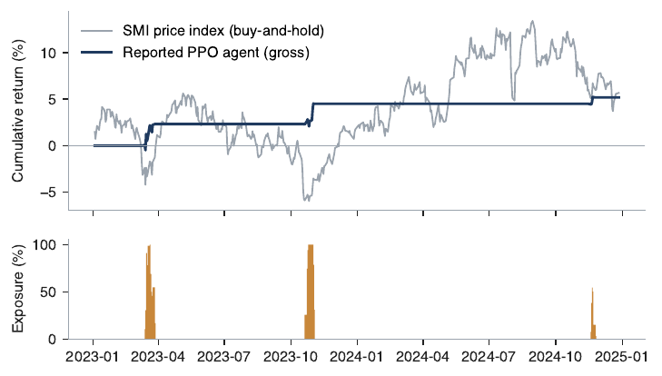
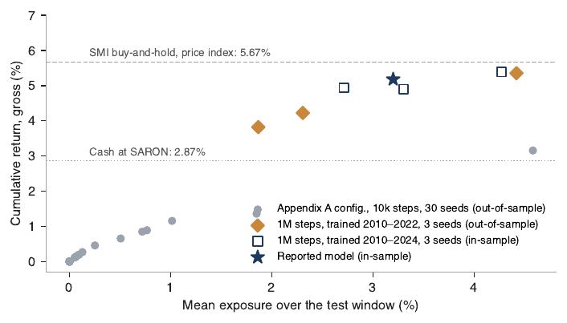

# Auditing my own result: a PPO exposure agent on the Swiss Market Index

**Short version:** my MSc thesis reported a reinforcement learning agent with a Sharpe ratio of 1.17 and a maximum drawdown of 0.77% on the Swiss Market Index (SMI), 2023 to 2024. After submitting, I audited it. The reported model had been trained on 2010 to 2024, so the test years were in its training data. This repository is the audit, including the parts that do not flatter the original result.

Full write-up (13 pages): [`paper/Pedro_Gaspar_PPO_SMI_portfolio.pdf`](paper/Pedro_Gaspar_PPO_SMI_portfolio.pdf)

## The question

A PPO agent chooses each day how much of its capital to hold in the SMI (0% to 100%). Does its good back-test show learned market timing, or can it be explained by how the experiment was built?

## What I did

1. **Checked the saved model.** Its file records 1,001,472 training timesteps on 2010 to 2024, with no validation loop. The thesis had described a shorter run on 2010 to 2022. So the reported numbers are in-sample.
2. **Ran an out-of-sample control.** Same configuration, trained only on 2010 to 2022, 3 seeds.
3. **Decomposed the result.** Measured how often the agent is actually invested, and re-did the comparison with the same accounting for every strategy (idle cash earns the Swiss short-term rate, same trading cost for all, benchmarks with dividends).
4. **Tested it formally.** Sharpe ratio differences with a studentized block bootstrap (Ledoit and Wolf, 2008) and Holm correction, over 30 + 10 + 6 trained agents.
5. **Redesigned the agent** (cost on trading, not on holding) and stress-tested both versions on 2020 and 2022.

## Results

| | |
|---|---|
| Reported (thesis, in-sample) | Sharpe 1.17, max drawdown 0.77% |
| Out-of-sample control (trained 2010 to 2022) | Sharpe 1.04 to 1.29, drawdown 0.62% to 1.08% |
| Days the reported agent is invested | 27 of 499 |
| Return, consistent accounting | 7.5% (agent) vs 14.3% (buy-and-hold, total return) vs 15.3% (real 60/40) |
| Sharpe difference vs benchmarks | not significant at 5% (p = 0.26 to 0.77) |



**What this means**

- The data leak did not create the result: the out-of-sample control behaves the same way.
- But the result is not market timing either. The reward charged 0.1% per day on the exposure held, about five times the index's average daily return. So the agent learned to sit in cash. The low drawdown comes from not being in the market.
- Under fair accounting the agent earns about half the return of the real benchmarks, and its Sharpe advantage cannot be told apart from noise.
- **Negative result:** a redesigned agent that pays a cost only when it trades does take real exposure, but its edge over simple rules is not significant and disappears at a cost of 0.25% per trade. In the 2020 and 2022 stress windows, neither agent showed learned de-risking.



The paper ends with a six-point checklist for testing DRL back-tests (check provenance, report exposure next to Sharpe, charge costs on trading, use the same accounting for all strategies, use many seeds and a formal test, use matched controls).

## Limitations

- The test window is 499 days, so the tests have low power.
- The control uses 3 seeds per arm.
- The Swiss interest rate series is a proxy built from the central bank policy rate.
- Taxes and bid-ask spreads are not modelled.
- This audits one agent on one index. It says nothing general about reinforcement learning in finance.

## Repository layout

```
paper/     write-up (PDF and LaTeX source) and the script that builds its figures
src/       experiments, statistical tests, control run, model re-evaluation
results/   saved outputs (JSON and CSV) behind every number in the paper
figs/      PNG figures used in this README
```

## How to run

Use Python 3.10 or newer. Run everything from the repository root.

```
pip install -r requirements.txt
python src/experiments.py          # downloads market data, trains agents (slow), writes results/
python src/stats_tests.py          # Sharpe tests, reads results/
cd paper && python make_figs.py    # rebuilds the paper figures from results/
```

To read the numbers without re-training, the files in `results/` are the saved outputs.

**Data.** The market data (SMI and two iShares ETFs from Yahoo Finance) is third-party and is not redistributed here. `src/experiments.py` downloads it with `yfinance` and caches it as `results/data.pkl`, which the other scripts read. `results/original_model_v2_test_path.csv` holds the reported model's exposure path together with the SMI daily returns on the test window, which `paper/make_figs.py` needs for Figure 1.

**Not included.** The original thesis model file and its data CSV (`original/`). `src/avaliar_modelo_original.py` and `src/controlo_1M.py` need them, so they are kept for transparency and cannot run without them. Their outputs are in `results/`. The 1M-timestep control takes hours on a laptop.

## Author

Pedro Gaspar, MSc Data Science and Advanced Analytics, NOVA IMS. pedro@gasparweb.pt

Released under the MIT licence.
